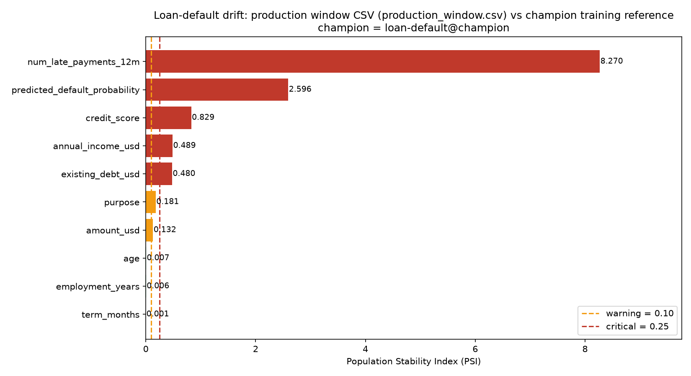

# Week 17 — Loan-default MLflow lifecycle report

**Project:** `D:\Techpreneur2.0\week17\loan-api`
**Environment:** Python 3.14.6, MLflow 3.17.2, scikit-learn 1.9.0, pandas 3.0.5, FastAPI/Uvicorn, Windows PowerShell.
**Tracking store:** `sqlite:///mlflow.db`; artifacts: `./mlartifacts`
**Experiment:** `loan-default-experiments` (ID 1), batch `20261112T062215Z`
**Data:** reproducible synthetic loan applications from `data/make_dataset.py` — 8,000 rows, 80/20 stratified split, 1,600-row holdout, 23.9% default rate. The 1,200-row `data/production_window.csv` is a deliberately drifted simulated production window for the monitoring lab; its default rate is 69.8%, versus 23.9% in the reference data, reflecting the simulated shift.

**Features and target:** the shared contract in `loan_features.py` uses eight numeric features (`amount_usd`, `term_months`, `annual_income_usd`, `credit_score`, `existing_debt_usd`, `employment_years`, `num_late_payments_12m`, `age`) plus one categorical feature (`purpose`). The target is `default` (1 = default, 0 = repaid).

## Deliverable summary

| Step | Deliverable | Status | Evidence |
|---|---|---|---|
| 1 | Six+ tracked runs across two+ model types | Done — 8 runs, 5 model families | `evidence/01_training.txt`, `evidence/01_leaderboard.txt`, `artifacts/leaderboard.csv` |
| 2 | Register two best candidates under `loan-default`; set champion/challenger; descriptions | Done — v1 champion, v2 challenger | `evidence/02_registry.txt`, `evidence/02_registry.json` |
| 3 | One-paragraph promotion memo citing recall, precision, AUC, with run links | Done | `memo.md` and section 3 below |
| 4 | Start three programs; test MLflow server incl. signature rejection; verify FastAPI/MLflow probability parity | Done — all three healthy; 400 rejection; diff 0.0 | `evidence/04_servers.txt`, `evidence/04_integration.txt`, `evidence/04_integration.json` |
| 5 | Run `monitor.py`; set alert thresholds from the chart | Done — PSI alert; 0.10 warning / 0.25 critical | `evidence/05_monitor.txt`, `artifacts/drift_report.png`, `artifacts/drift_report.json` |
| 6 | Move champion, restart FastAPI, check `/health`; move back, restart, check again | Done — v2 then back to v1 | `evidence/06_rollback.txt`, `evidence/06_rollback.json` |

---

## 1. Experiment — eight tracked runs across five model families

Command:

```powershell
$env:MLFLOW_TRACKING_URI="http://127.0.0.1:5000"
python train_tracked.py --reset-registry
```

`train_tracked.py` logs parameters, metrics, the dataset input, a model signature, an input example, and a `metrics.json` artifact for every run. The final batch produced:

| Rank | Run | Model family | Recall | Precision | ROC-AUC | PR-AUC | Business score | Run ID |
|---:|---|---|---:|---:|---:|---:|---:|---|
| 1 | logreg-regularized | logistic_regression | 0.7546 | 0.4573 | 0.8188 | 0.6113 | 0.6782 | `d400758e6cbe4ed2a0b36d4b85fe32b8` |
| 2 | logreg-balanced | logistic_regression | 0.7546 | 0.4573 | 0.8188 | 0.6113 | 0.6782 | `a09970e6b164432a977ae9b699651db8` |
| 3 | random-forest-shallow | random_forest | 0.7232 | 0.4556 | 0.8079 | 0.5862 | 0.6599 | `a9bff6ebe65947babc72b73671e6af7e` |
| 4 | extra-trees | extra_trees | 0.6945 | 0.4602 | 0.8088 | 0.5900 | 0.6471 | `e439269ee36d4a19adf28189a62add2a` |
| 5 | random-forest-deep | random_forest | 0.5979 | 0.5545 | 0.8041 | 0.5735 | 0.6261 | `2035d66a40364cf980d195584cd44866` |
| 6 | hist-gradient-boosting | hist_gradient_boosting | 0.6240 | 0.4761 | 0.7881 | 0.5737 | 0.6124 | `9546b712ccc24d6fbf4d60b69a9b3caa` |
| 7 | logreg-baseline | logistic_regression | 0.4386 | 0.6292 | 0.8191 | 0.6119 | 0.5719 | `54e27f43aa974c5fa729d043f9bc3394` |
| 8 | gradient-boosting | gradient_boosting | 0.4334 | 0.6264 | 0.8110 | 0.5989 | 0.5668 | `dfc2c9a108914241be88817f38ec543f` |

All metrics are computed on the same held-out 1,600 applications at a 0.5 threshold. The business score is `0.5 × recall + 0.3 × precision + 0.2 × ROC-AUC`; recall is weighted highest because a missed default is assumed to cost about five times a wrongly declined good applicant. Runs are selected per model family first (`drop_duplicates(subset="model_family")` in `train_tracked.py:375`), then the top two families become champion and challenger. This avoids promoting two near-identical variants of the same family.

Run links (local MLflow server on port 5000):

- [logreg-regularized](http://127.0.0.1:5000/#/experiments/1/runs/d400758e6cbe4ed2a0b36d4b85fe32b8)
- [logreg-balanced](http://127.0.0.1:5000/#/experiments/1/runs/a09970e6b164432a977ae9b699651db8)
- [random-forest-shallow](http://127.0.0.1:5000/#/experiments/1/runs/a9bff6ebe65947babc72b73671e6af7e)
- [extra-trees](http://127.0.0.1:5000/#/experiments/1/runs/e439269ee36d4a19adf28189a62add2a)
- [random-forest-deep](http://127.0.0.1:5000/#/experiments/1/runs/2035d66a40364cf980d195584cd44866)
- [hist-gradient-boosting](http://127.0.0.1:5000/#/experiments/1/runs/9546b712ccc24d6fbf4d60b69a9b3caa)
- [logreg-baseline](http://127.0.0.1:5000/#/experiments/1/runs/54e27f43aa974c5fa729d043f9bc3394)
- [gradient-boosting](http://127.0.0.1:5000/#/experiments/1/runs/dfc2c9a108914241be88817f38ec543f)

Evidence: `evidence/01_training.txt` (full terminal output), `evidence/01_leaderboard.txt`, `artifacts/leaderboard.csv`, `artifacts/leaderboard.json`.

---

## 2. Register and assign roles

The two best candidates were registered under the single registry name `loan-default`. The champion is `logreg-regularized`; the challenger is `random-forest-shallow` (the best run from a different model family).

| Version | Alias | Run | Description |
|---|---|---|---|
| 1 | `champion` | `d400758e6cbe4ed2a0b36d4b85fe32b8` | Champion: logreg-regularized (logistic_regression). Recall=0.7546, precision=0.4573, ROC-AUC=0.8188, PR-AUC=0.6113. Trained on 6400 applications (batch 20261112T062215Z); MLflow run d400758e6cbe4ed2a0b36d4b85fe32b8. |
| 2 | `challenger` | `a9bff6ebe65947babc72b73671e6af7e` | Challenger: random-forest-shallow (random_forest). Recall=0.7232, precision=0.4556, ROC-AUC=0.8079, PR-AUC=0.5862. Trained on 6400 applications (batch 20261112T062215Z); MLflow run a9bff6ebe65947babc72b73671e6af7e. |

Registry evidence:

```text
Registered model: loan-default
Versions        : 2
Aliases distinct: True
Descriptions    : all present

Aliases
  champion   -> v1  run=d400758e6cbe4ed2a0b36d4b85fe32b8
  challenger -> v2  run=a9bff6ebe65947babc72b73671e6af7e
```

Each version also carries tags `role`, `run_id`, `model_family`, `business_score`, and `batch_id`. Evidence: `evidence/02_registry.txt`, `evidence/02_registry.json`.

---

## 3. Decide — promotion memo

> **Decision:** Promote `logreg-regularized` (registry version 1, run `d400758e6cbe4ed2a0b36d4b85fe32b8`) to `@champion` and keep `random-forest-shallow` (version 2, run `a9bff6ebe65947babc72b73671e6af7e`) as `@challenger`. I am choosing `logreg-regularized` as champion because it is the strongest candidate on the business-critical metrics on the 1,600-application stratified holdout. It reaches **recall 0.7546**, **precision 0.4573**, and **ROC-AUC 0.8188** (PR-AUC 0.6113), compared with the challenger `random-forest-shallow` at **recall 0.7232**, **precision 0.4556**, and **ROC-AUC 0.8079** (PR-AUC 0.5862). The champion therefore catches 75.5% of actual defaulters — 3.1 percentage points more than the challenger — while keeping precision essentially unchanged (45.7% vs 45.6%) and ranking applicants better by AUC (+0.011). Because a missed default is assumed to cost roughly five times as much as a wrongly declined good applicant, recall carries the largest weight in the selection score (`0.5 × recall + 0.3 × precision + 0.2 × AUC`); the champion wins on recall, precision, and AUC simultaneously, so the promotion does not trade one objective for another. The challenger remains registered and aliased for shadow evaluation and one-command rollback.
>
> - Champion run: <http://127.0.0.1:5000/#/experiments/1/runs/d400758e6cbe4ed2a0b36d4b85fe32b8>
> - Challenger run: <http://127.0.0.1:5000/#/experiments/1/runs/a9bff6ebe65947babc72b73671e6af7e>

Standalone copy: `memo.md`.

---

## 4. Serve and integrate

Three programs were started for Hands-on 1:

| Program | Command | Address | Health |
|---|---|---|---|
| MLflow tracking server | `python -m mlflow server --backend-store-uri sqlite:///mlflow.db --artifacts-destination ./mlartifacts --host 127.0.0.1 --port 5000` | `http://127.0.0.1:5000` | 200 `OK` |
| MLflow scoring server | `python -m mlflow models serve -m models:/loan-default@champion --host 127.0.0.1 --port 5001 --env-manager local` | `http://127.0.0.1:5001` | 200 |
| FastAPI service | `python -m uvicorn main:app --host 127.0.0.1 --port 8000` | `http://127.0.0.1:8000` | 200, champion v1 loaded |

FastAPI resolves the model only through the registry alias:

```python
# main.py:53
model_uri = f"models:/{MODEL_NAME}@{MODEL_ALIAS}"
```

No local model file or version number is used by the service.

### 4.1 MLflow scoring server — valid request

Request to `POST http://127.0.0.1:5001/invocations`:

```json
{
  "dataframe_split": {
    "columns": ["amount_usd", "term_months", "purpose", "annual_income_usd", "credit_score", "existing_debt_usd", "employment_years", "num_late_payments_12m", "age"],
    "data": [[1500, 12, "Buy a rice thresher", 9000.0, 640, 2500.0, 4.5, 1, 38]]
  }
}
```

Response:

```text
HTTP 200
{"predictions": [{"default_probability": 0.2534030951697195}]}
```

### 4.2 MLflow scoring server — signature rejection

The same applicant with the required `credit_score` column removed:

```text
HTTP 400
{
  "error_code": "INVALID_PARAMETER_VALUE",
  "message": "... Error: Model is missing inputs ['credit_score'].",
  "error_class": "SCHEMA_ENFORCEMENT_FAILED"
}
```

The model signature rejected the request before scoring. The full response is in `evidence/04_integration.json`.

### 4.3 FastAPI vs MLflow probability parity

The same applicant was sent to FastAPI `POST /predict` and to the MLflow scoring server:

| Client | Default probability |
|---|---:|
| MLflow scoring server (`/invocations`) | 0.2534030951697195 |
| FastAPI (`/predict`) | 0.2534030951697195 |
| Absolute difference | **0.0** |

The two servers return exactly the same probability because both load the same registered model and use the same signature. Evidence: `evidence/04_servers.txt`, `evidence/04_integration.txt`, `evidence/04_integration.json`.

---

## 5. Monitor — drift chart and alert thresholds

Command:

```powershell
$env:MLFLOW_TRACKING_URI="http://127.0.0.1:5000"
python monitor.py
```

`monitor.py` computes PSI for every model feature and for the champion's predicted default probability, comparing the production window with the champion's training reference (`artifacts/reference_train.csv`). It prefers `logs/predictions.jsonl` once it contains at least 200 live predictions; for this run it used the 1,200-row simulated production window.

| Feature / signal | PSI | Status |
|---|---:|---|
| num_late_payments_12m | 8.2703 | CRITICAL |
| predicted_default_probability | 2.5960 | CRITICAL |
| credit_score | 0.8288 | CRITICAL |
| annual_income_usd | 0.4888 | CRITICAL |
| existing_debt_usd | 0.4803 | CRITICAL |
| purpose | 0.1814 | WARNING |
| amount_usd | 0.1321 | WARNING |
| age | 0.0075 | OK |
| employment_years | 0.0056 | OK |
| term_months | 0.0014 | OK |



**Alert thresholds, calibrated from the chart:**

- **Warning: PSI ≥ 0.10.** The stable cluster (age, employment_years, term_months) stayed at or below 0.0075, while the next cluster (amount_usd 0.1321, purpose 0.1814) is above 0.13. The 0.10 line sits in the empty gap between stable and moderate drift.
- **Critical: PSI ≥ 0.25.** The clearly shifted features start at 0.4803 (existing_debt_usd) and rise to 8.2703 (num_late_payments_12m). The 0.25 line sits above the moderate cluster and below the large-shift cluster, so it flags a genuine distribution change rather than normal noise. Any critical feature raises an alert.
- **Dataset alert:** at least 3 features at or above the warning threshold.
- **Prediction alert:** predicted-probability PSI ≥ 0.25.

The run raised an alert (exit code 1):

```text
ALERT: drift thresholds crossed.
  Critical feature drift: annual_income_usd, credit_score, existing_debt_usd, num_late_payments_12m
  Dataset alert: >= 3 features at/above warning.
  Prediction PSI 2.5960 >= 0.25.
  Recommended action: investigate the shifted features and retrain a challenger.
```

Evidence: `evidence/05_monitor.txt`, `artifacts/drift_report.png`, `artifacts/drift_report.json`, `artifacts/monitor_config.json`.

---

## 6. Roll back the champion alias

The rollback was automated by `evidence/rollback_test.py`: it moves the alias with `MlflowClient.set_registered_model_alias`, stops the FastAPI process, starts a fresh `uvicorn main:app` process, waits for `/health`, and repeats after moving the alias back.

```python
from mlflow import MlflowClient
client = MlflowClient("http://127.0.0.1:5000")

client.set_registered_model_alias("loan-default", "champion", "2")  # roll forward
# restart FastAPI

client.set_registered_model_alias("loan-default", "champion", "1")  # roll back
# restart FastAPI
```

| Stage | Champion alias | `/health` version | `/health` run ID | `/predict` probability | Restart |
|---|---|---|---:|---|---|
| Before rollback | v1 | 1 | `d400758e6cbe4ed2a0b36d4b85fe32b8` | 0.2534030951697195 | — |
| After moving champion to v2 | v2 | 2 | `a9bff6ebe65947babc72b73671e6af7e` | 0.27138532990893294 | stopped PID 20344, new PID 10928 |
| After moving champion back to v1 | v1 | 1 | `d400758e6cbe4ed2a0b36d4b85fe32b8` | 0.2534030951697195 | stopped PID 10928, new PID 2812 |

Both checks passed: `verified_forward=True` and `verified_back=True`. The served probability changed when the alias moved and returned to the original value after rollback, confirming the API follows the alias rather than a cached file or version number. Evidence: `evidence/06_rollback.txt`, `evidence/06_rollback.json`.

---

## Assessment criteria

1. **All six deliverables present, with evidence.** The summary table links every deliverable to terminal output, JSON evidence, or artifacts.
2. **Promotion decision uses business-relevant metrics.** The selection score weights recall at 50%, precision at 30%, and AUC at 20%, with a precision ≥ 0.40 and AUC ≥ 0.75 guardrail. The memo cites recall, precision, and AUC and explains the cost asymmetry (missed default ≈ 5× a wrongly declined applicant).
3. **The API loads by alias, not by file or version number.** `main.py:53` uses `models:/loan-default@champion`; the rollback test proves the alias is the serving switch.
4. **Drift alert thresholds are justified from the chart.** The 0.10 warning and 0.25 critical lines sit in the observed gaps between the stable (<0.01), moderate (0.13–0.18), and large-shift (≥0.48) PSI clusters.

## Reproduction

```powershell
cd D:\Techpreneur2.0\week17\loan-api
python data/make_dataset.py
$env:MLFLOW_TRACKING_URI="http://127.0.0.1:5000"

# Terminal 1: tracking server
python -m mlflow server --backend-store-uri sqlite:///mlflow.db --artifacts-destination ./mlartifacts --host 127.0.0.1 --port 5000

# Terminal 2: train and register
python train_tracked.py --reset-registry

# Terminal 3: scoring server
python -m mlflow models serve -m models:/loan-default@champion --host 127.0.0.1 --port 5001 --env-manager local

# Terminal 4: FastAPI
python -m uvicorn main:app --host 127.0.0.1 --port 8000

# Evidence checks
python evidence/check_integration.py
python monitor.py
python evidence/rollback_test.py
```

## File inventory

- Code: `train_tracked.py`, `loan_model.py`, `loan_features.py`, `main.py`, `monitor.py`, `data/make_dataset.py`
- Data: `data/loan_default.csv`, `data/production_window.csv`
- Registry/run artifacts: `artifacts/leaderboard.csv`, `artifacts/leaderboard.json`, `artifacts/selected_versions.json`, `artifacts/reference_train.csv`
- Monitoring artifacts: `artifacts/drift_report.png`, `artifacts/drift_report.json`, `artifacts/monitor_config.json`
- Report and memo: `report.md`, `memo.md`
- Evidence: `evidence/01_training.txt`, `evidence/01_leaderboard.txt`, `evidence/02_registry.txt`, `evidence/02_registry.json`, `evidence/04_servers.txt`, `evidence/04_integration.txt`, `evidence/04_integration.json`, `evidence/05_monitor.txt`, `evidence/06_rollback.txt`, `evidence/06_rollback.json`
- Evidence scripts: `evidence/check_integration.py`, `evidence/registry_evidence.py`, `evidence/rollback_test.py`, `evidence/make_leaderboard_evidence.py`
- Server logs: `evidence/servers/*.log`
